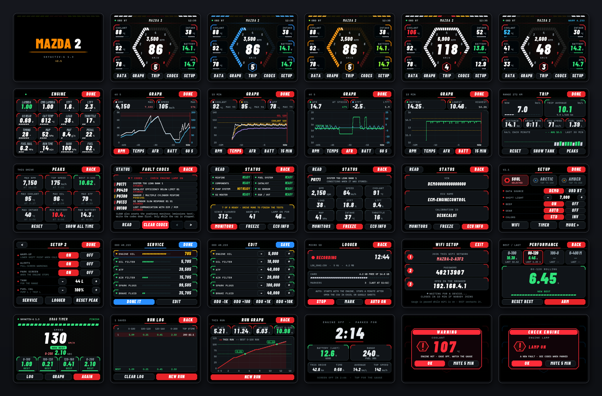

# 🚗 REDLINE Flasher — SmartGauge Mazda2 Skyactiv

  <b>ESP32-CYD Firmware Flashing Tool</b> 
  A simple tool to flash SmartGauge Mazda2 Skyactiv firmware.

---

## 📥 Downloads

### 🖥️ REDLINE Flasher

Download the Windows flashing utility created by Birdlab.

- **File:** `REDLINE-Flasher-windows.exe`
- **Author:** [Birdlab](https://github.com/moomdate)
- **Platform:** Windows

### ⚙️ SmartGauge Firmware

Firmware for the SmartGauge Mazda2 Skyactiv project.

- **File:** `SmartGauge-Mazda2Skyactiv.bin`
- **Device:** ESP32-2432S028

---

## 🔧 Flashing Instructions

### 1. Connect Your Device
Connect the ESP32-CYD to your PC using a USB data cable.

### 2. Launch REDLINE Flasher
Run the application:

`REDLINE-Flasher-windows.exe`

### 3. Configure Settings

Select the correct COM Port and configure the following settings:

| Setting | Value |
|:--|:--|
| COM Port | Select the correct port |
| Panel | `invert` |
| Display | `80 MHz` |
| Install (First Installation) | `factory` |
| Install (Firmware Update) | `update` |

### 4. Select Firmware

Click **Browse** and select:

`SmartGauge-Mazda2Skyactiv.bin`

### 5. Flash Firmware

Click **Flash** to start the flashing process.

Wait for the process to complete. Do not disconnect the USB cable while flashing.

### 6. Restart

Once flashing is complete, the device will restart automatically.

---

## ✅ Recommended Settings

For the first installation, use these settings:

| Parameter | Recommended Value |
|:--|:--|
| Panel | `invert` |
| Display | `80 MHz` |
| Install | `factory` |
| Firmware | `SmartGauge-Mazda2Skyactiv.bin` |

> **Note:** Select `update` when updating an existing firmware installation.

---

## ⚠️ Important Notes

- Ensure the correct COM Port is selected.
- Use a USB cable that supports data transfer.
- Do not disconnect the device during flashing.
- Make sure you select the correct firmware file.

---

## 👨‍💻 Credits

**REDLINE Flasher** created by [Birdlab](https://github.com/moomdate).

Developed for flashing SmartGauge Mazda2 Skyactiv firmware
to ESP32-CYD devices.

---

  <b>REDLINE Flasher</b> 
  <i>SmartGauge Mazda2 Skyactiv · ESP32-CYD</i>

